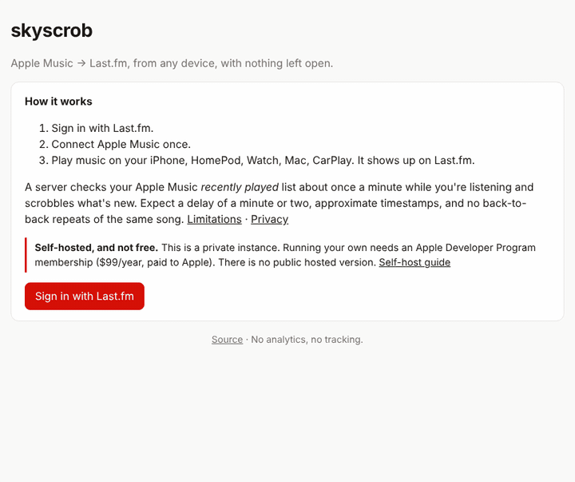

# skyscrob

**Scrobble Apple Music to Last.fm from any device: iPhone, HomePod, Apple Watch, CarPlay, Mac.
Nothing to install or keep open on your devices.** Connect Apple Music and Last.fm once, and a
small server you run on Cloudflare does the rest in the background.

> [!IMPORTANT]
> **This is not free.** To run skyscrob you need your own **Apple Developer Program membership,
> $99/year.** Apple requires it for any access to a user's Apple Music listening data. There is
> no free tier and no way around it. Cloudflare (free plan) and Last.fm (API key) cost nothing.
>
> **There is no public hosted version.** Self-host only, with your own Apple developer account.
> A shared instance is on hold until Apple confirms in writing that it's allowed
> ([why](docs/tos-notes.md)).



<sub>Demo recorded against the bundled mock Apple Music / Last.fm servers
(`scripts/mock-upstreams.mjs`), sped up. Not real listening data.</sub>

> Status: **v0.x, early.** The scrobble engine is tested heavily against simulated listening and
> fake Apple/Last.fm servers. The real-world behaviour of Apple's API (exact delay, edge cases) is
> still being measured: see [`docs/feasibility.md`](docs/feasibility.md).

## Why

Apple Music doesn't scrobble. Every existing option needs something running where you listen:
an app on your phone that iOS may kill in the background, or a Mac with Music open. Neither
covers a HomePod, a Watch on a run, or CarPlay. skyscrob reads the one thing that sees all of
those, your Apple Music **recently played** list, from the cloud.

## How it works

```
 your devices ──play──▶ Apple Music ──"recently played" list──▶ skyscrob (Cloudflare Worker, every minute)
                                                                    │  diff against last snapshot
                                                                    │  estimate start times
                                                                    ▼
                                                               Last.fm (now playing + scrobbles)
```

1. Once a minute (backing off to 3, 5, then 10 minutes when you've been idle), the Worker
   fetches `GET /v1/me/recent/played/tracks` from the Apple Music API with your Music User Token.
2. It compares that list to the previous one. Songs that appeared at, or jumped to, the top are
   new plays.
3. A new song on top is sent to Last.fm as **now playing**. It's **scrobbled** once it has been
   on top longer than Last.fm's rule (half the song or 4 minutes), or when the next song
   replaces it and it was played long enough. Clear skips aren't scrobbled.
4. Before sending, it checks your Last.fm history so plays another scrobbler already sent (say,
   one on your Mac) aren't duplicated.

## Limitations

Apple's API was not built for this. Read these before relying on it:

- **Timestamps are estimates.** Apple says _what_ you played, never _when_. skyscrob estimates
  start times from when it noticed the change. In simulation that's within ~20 s (median) /
  ~30 s (90th percentile) while you're listening, and off by minutes after an idle stretch. On
  Last.fm the order is right but the times can be slightly off.
- **Delay.** Plays show up on Last.fm 1–3 minutes after they reach Apple's list, longer when
  you start listening after being idle (polling backs off to every 10 min). Never "live".
- **Back-to-back repeats are invisible.** Play the same song twice in a row (or on repeat-one)
  and the list doesn't change, so it's scrobbled once. Replaying a song _later_, after other
  songs, is caught.
- **Quick skips can slip through.** With one-minute polling, a skip that lands across a poll
  can look like a minute of listening. In simulation about a quarter of under-25-second skips
  get scrobbled anyway, mostly on songs shorter than ~3 minutes.
- **The last song before you stop listening is scrobbled even if you stopped it early.** From
  Apple's list, "stopped after 20 s" and "played to the end" look the same.
- **The song playing when you connect isn't scrobbled**, nor anything before it. History is
  never back-filled.
- **More than 30 songs between two polls** (only possible after a long outage): only the newest
  30 are scrobbled, with squeezed timestamps.
- **Podcasts, audiobooks, music videos** aren't scrobbled. Radio and stations depend on what
  Apple puts in the list (see `docs/feasibility.md`).
- **Apple Music User Tokens expire** (reportedly ~6 months). The dashboard shows a banner and
  you click _Reconnect_. Nothing is scrobbled until you do.

## Self-host

You run your own copy with your own keys. Self-hosting is currently the only way to use skyscrob.

**Cost: $99/year**, for the Apple Developer Program, paid to Apple. Apple requires it for any
Apple Music API access, and there's no free tier. Cloudflare's free plan and the Last.fm API
are free. skyscrob itself is free and open source and will stay non-commercial.

### What you need

1. **Apple Developer Program** membership ($99/yr): <https://developer.apple.com/programs/enroll/>
   - Certificates, Identifiers & Profiles → **Identifiers** → `+` → **Media IDs** → enable
     MusicKit → register.
   - **Keys** → `+` → name it, tick **Media Services (MusicKit, ShazamKit, Apple Music Feed)**,
     configure it with your Media ID → continue → **Download** the `AuthKey_XXXXXXXXXX.p8`
     (you can only download it once) and note the **Key ID**.
   - **Membership** page → note your **Team ID**.
2. **Last.fm API account**: <https://www.last.fm/api/account/create>. Note the **API key** and
   **shared secret**.
3. **Cloudflare account** (free): <https://dash.cloudflare.com/sign-up>
4. **Node.js 22+** on your computer.

### Install (about 5 minutes)

```bash
git clone https://github.com/ag0nyy-ops/lastfm-apple-music-scrobblier.git skyscrob
```

```bash
cd skyscrob && npm install
```

```bash
npm run setup
```

The setup script logs you in to Cloudflare, asks for the values above, creates the database,
deploys, and stores your secrets encrypted in Cloudflare. It prints your URL
(`https://skyscrob.<you>.workers.dev`). Open it, **Sign in with Last.fm**, then **Connect
Apple Music**. Done. Play something.

Your instance only lets in the Last.fm username(s) you gave during setup, so nobody else can
use your Apple key.

<details>
<summary>Manual setup (what the script does)</summary>

```bash
npx wrangler login
npx wrangler d1 create skyscrob          # put the database_id in wrangler.toml
npx wrangler d1 migrations apply skyscrob --remote
npx wrangler deploy
npx wrangler secret put APPLE_TEAM_ID
npx wrangler secret put APPLE_KEY_ID
npx wrangler secret put APPLE_PRIVATE_KEY < AuthKey_XXXXXXXXXX.p8
npx wrangler secret put LASTFM_API_KEY
npx wrangler secret put LASTFM_API_SECRET
node -e "console.log(require('crypto').randomBytes(32).toString('base64'))" | npx wrangler secret put ENCRYPTION_KEY
```

Then set `ALLOWED_LASTFM_USERS` in `wrangler.toml` to your Last.fm username and deploy again.

</details>

### Updating

```bash
git pull && npm install && npx wrangler d1 migrations apply skyscrob --remote && npx wrangler deploy
```

### Costs and limits on Cloudflare's free plan

One cron run per minute = ~1,440 Worker invocations/day plus your dashboard visits, well under
the free 100k/day. Each run polls up to `POLL_BATCH_SIZE` users (default 5). Each user costs
about 6–7 D1 queries per run, and the free plan allows 50 per invocation. That's plenty for
yourself and a few friends. Beyond that, see below.

## Hosted mode (on hold)

The code supports a shared multi-user instance (`ALLOWED_LASTFM_USERS = "*"`): encrypted tokens,
per-user leases, rate limits, delete-my-data. **Nobody should run one yet.** Here's what has to be
true first ([`docs/launch-checklist.md`](docs/launch-checklist.md)):

1. **Apple's written OK.** Apple's MusicKit terms restrict using "music-related text" apart from
   playback. On-device scrobbler apps exist, but a server holding strangers' tokens is a
   different thing. If Apple objects, the operator's key gets revoked and everyone breaks at
   once. Asked; no answer yet.
2. **Last.fm's API terms, checked live** for a multi-user service. They couldn't be fetched when
   the notes in `docs/tos-notes.md` were written.
3. **Strictly non-commercial.** No paid tier, no ads, and no donate button either: Apple bans
   "indirectly monetizing" access, and it's unclear whether donations count. Last.fm needs a
   separate agreement for commercial use.
4. **The operator pays for everything:** $99/yr Apple Developer Program plus the Workers Paid
   plan ($5/month at the time of writing).
5. **Scale settings:** on Workers Paid (1,000 D1 queries per invocation) set
   `POLL_BATCH_SIZE = "100"`, which polls up to ~100 users a minute. Past a few hundred active
   users, move polling to Cloudflare Queues ([`docs/future.md`](docs/future.md)).

## Privacy

No analytics, no telemetry, no ads, no third-party scripts except Apple's own MusicKit JS
(loaded from Apple, only when you click Connect). The server stores your encrypted tokens, your
settings, and the last 14 days of scrobbles, nothing else. "Delete all my data" deletes it all.
Details in [`PRIVACY.md`](PRIVACY.md).

## Settings

On the dashboard, all off by default except now playing:

- Show "now playing" on Last.fm
- Remove " - Single" / " - EP" from album names
- Remove "(Remastered …)" / " - 2011 Remaster" from track and album names
- Use the album artist as the artist (only when Apple provides it; see `APPLE_INCLUDE_ALBUMS`)

Server-side (`wrangler.toml` → `[vars]`):

| Variable                | Default         | Meaning                                                                      |
| ----------------------- | --------------- | ---------------------------------------------------------------------------- |
| `ALLOWED_LASTFM_USERS`  | (setup sets it) | Comma-separated Last.fm usernames allowed to sign in, or `*`                 |
| `DETECTION_MODE`        | `start`         | Whether Apple lists a song when it starts (`start`) or after it ends (`end`) |
| `DETECTION_LAG_SECONDS` | `20`            | Typical delay before a play shows up in Apple's list                         |
| `POLL_BATCH_SIZE`       | `5`             | Users polled per cron run (free plan: ≤ 5; Workers Paid: ~100)               |
| `APPLE_INCLUDE_ALBUMS`  | `false`         | Ask Apple for album data (album artist)                                      |

## Troubleshooting

- **Nothing shows up.** Dashboard → is Apple Music "Connected" and "Last checked" recent? On your
  iPhone, check **Settings → Music → Use Listening History** is on. Apple doesn't add plays to
  your history with it off. Then `npx wrangler tail` shows each poll (no tokens are logged).
- **"Apple rejected the developer token."** Team ID, Key ID or `.p8` is wrong, or the key
  doesn't have Media Services enabled. Re-run `npm run setup` and answer yes to "update secrets".
- **"Apple Music access expired".** Hit _Reconnect Apple Music_. Tokens expire after a while.
- **"Last.fm session is no longer valid."** You revoked it on last.fm. Sign in again.
- **"This instance is private."** Your Last.fm username isn't in `ALLOWED_LASTFM_USERS`.
- **Connect button does nothing / popup blocked.** Allow popups for your workers.dev domain;
  Apple's sign-in opens in a popup.
- **Duplicates with another scrobbler.** skyscrob skips plays already on your Last.fm within
  a few minutes of its estimate. If you see doubles, open an issue with times from both.
- **Timestamps look a bit off.** Expected, see [Limitations](#limitations).

## Development

```bash
npm install
```

```bash
npm test          # unit + integration tests, no network
```

```bash
npm run typecheck && npm run lint
```

Try the whole thing locally without any accounts, using the bundled fake Apple/Last.fm:

```bash
node scripts/mock-upstreams.mjs
```

Then copy `.dev.vars.example` to `.dev.vars` (point `APPLE_API_BASE` etc. at the mock as described
in the script header) and run `npx wrangler dev --test-scheduled`.

Layout: `src/core/` is the pure scrobble engine (diff, timestamp estimation, dedupe), where the
interesting bugs live and most tests point. `src/service.ts` is the cron loop, `src/http.ts` the
web routes, `public/` the dashboard. `spike/` is the Phase 0 measurement tooling.

See [`CONTRIBUTING.md`](CONTRIBUTING.md). Ideas for later: [`docs/future.md`](docs/future.md).

## License

MIT. Not affiliated with Apple or Last.fm. Apple Music is a trademark of Apple Inc.
